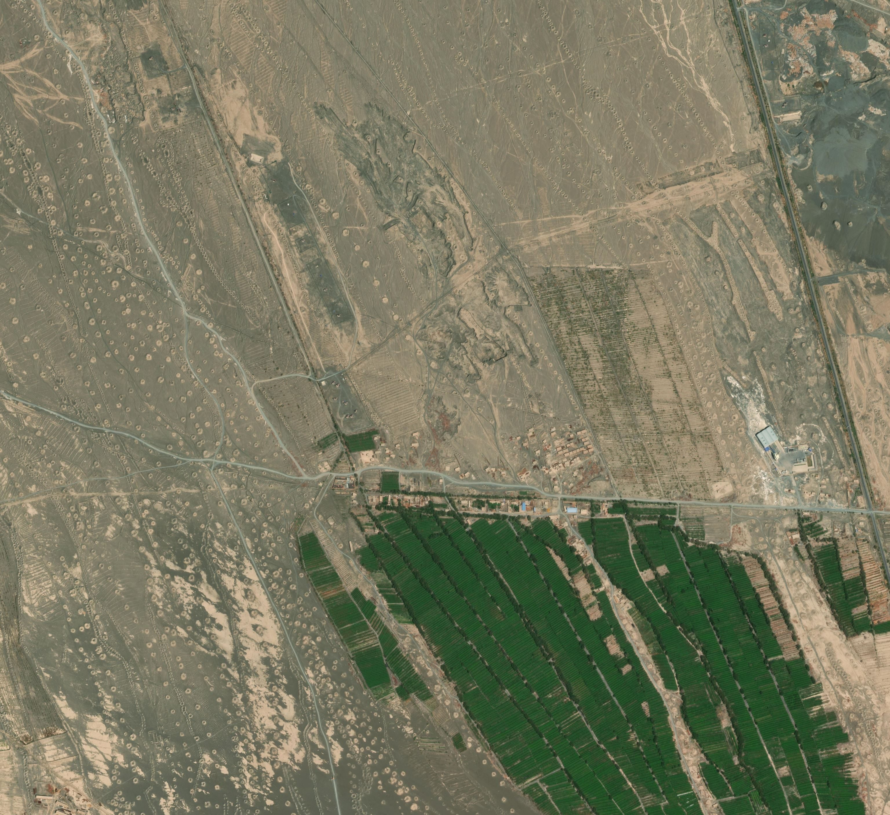

# Q-RITE — Qanat Shaft-Row Viewer

An offline, interactive map of qanat (underground irrigation gallery) shaft rows and road crossings in the Turpan Basin, China. One page, five windows, no installation: **open `index.html` in a browser and it works.**

*Preview: the north-dense window — detected shafts, traced rows, roads and a road–row crossing over a Bing image overlay.*

## What it shows

| | |
|---|---|
| Windows | 5 (~2.5 km each) in the Turpan Basin |
| Detected shafts | 5,664 |
| Traced shaft rows | 316 (111.7 km) |
| Road–row crossings | 12 |

Each window is clipped to the 2nd–98th percentile of detected shafts, so the map is covered with points rather than empty ground.

## About this project

Q-RITE maps qanat shaft rows and the road corridors that cross them. The dots on this map come from a **trained detector**, not hand digitising: a YOLOv8s initialised from a COCO-pretrained `yolov8s.pt`, then fine-tuned on a **public third-party dataset** — *Qanat-ActivityStates-YOLO* (Fu et al., 2026; Zenodo, [doi:10.5281/zenodo.18636032](https://doi.org/10.5281/zenodo.18636032), CC BY 4.0; 6,947 tiles at 1,280 px, split 6,355 / 392 / 200). We state this openly so the map can be read correctly: the five windows here were delimited **after** training, for inference and display, so the corridors compared on this page are not part of the training data. The upstream deposit has no geographic hold-out, so its validation score is used only to pick weights, never reported as independent accuracy. Shaft detection is the detector's only job; rows, crossings and route options are computed geometrically from its output.

## Run it

- **Locally:** unzip the folder and double-click `index.html` (Chrome / Edge / Firefox). No server, no internet, no build.
- **On GitHub:** push this folder to a repository root and turn on **Pages → Source: main / root**. Every path is relative, so the page serves as-is.
- Optional local server, if your browser blocks local files: `python -m http.server 8000` → <http://127.0.0.1:8000/>.

## Use it

- Pick a window from the left-hand list.
- **Zoom** with the wheel; **pan** by dragging (hold **Shift** to pan while picking endpoints).
- Zoom, layer visibility and language are saved; append `?lang=en` to start in English.
- **Route comparison** (the one interactive tool): click **Pick endpoints**, click two points on the map, then **Optimise**. Change the **detour cap** (5 / 10 / 20% / unlimited) and the recommended line is recomputed — the option that buries the least qanat within that cap. Lines are colour-coded and tabulated below.
- Deep link to a finished comparison: `index.html?site=north-dense&wps=LON,LAT;LON,LAT&auto=1&lang=en`.

The legend at the top of the page names every symbol: bright-green dots are shafts on a row, orange dots are isolated detections, green lines are traced rows (dashed = weak fit), blue/cyan lines are paved/unpaved roads, and red squares are true geometric crossings.

## A note on counting

"Shafts" on this page are **all detections** in a window, including points that never joined a row. Table 1 in the paper counts only shafts **assigned to a row**. The two numbers differ by definition, not by data.

## Data & credits

Shaft and row geometry is the detection/tracing output of the Q-RITE study. Imagery is a mosaic of Bing Maps tiles (© Microsoft); roads are from OpenStreetMap (© OpenStreetMap contributors, ODbL). The page redistributes only the derived vectors and the small image overlays needed for demonstration — see [TECHNICAL.md](TECHNICAL.md) for how it is built.

[中文说明](README_zh.md) · [技术说明 / Technical notes](TECHNICAL.md)
