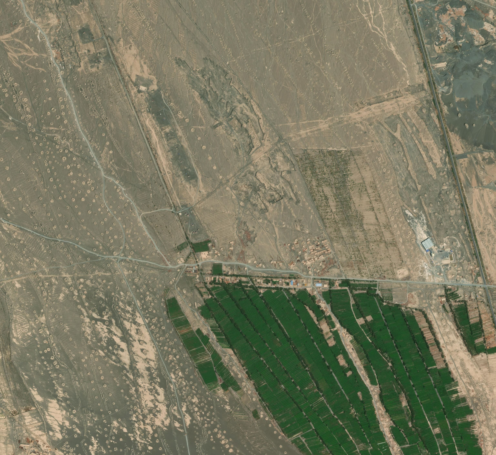

# Q-RITE · 坎儿井井链可视化平台

一个离线交互地图：吐鲁番盆地五个窗口里的坎儿井井口、井链与道路交叉。不用安装、不用联网——**双击 `index.html` 就能看。**

*预览：北部密井段窗口——影像上的检出井口、追踪井链、道路与一处道路–井链交叉。*

## 里面有什么

| | |
|---|---|
| 窗口 | 吐鲁番盆地 5 个（各约 2.5 km） |
| 检出井口 | 5,664 |
| 井链 | 316 条（111.7 km） |
| 道路–井链交叉 | 12 处 |

每个窗口按检出井口的 2%–98% 分位裁切，所以图上到处是点，而不是大片空地。

## 关于本项目

Q-RITE 绘制坎儿井井链及其与道路走廊的交叉。图上的井口来自**训练好的检测器**，不是人工描点：检测器为 YOLOv8s，以 COCO 预训练的 `yolov8s.pt` 初始化，再在一个**公开的第三方数据集**上微调——*Qanat-ActivityStates-YOLO*（Fu 等，2026；Zenodo，[doi:10.5281/zenodo.18636032](https://doi.org/10.5281/zenodo.18636032)，CC BY 4.0；6,947 张 1,280 px 瓦片，train/val/test = 6,355 / 392 / 200）。这里如实写明，是为了让图能被正确解读：这五个窗口是训练**之后**为推理与展示圈定的，所以本页比选的走廊不属于训练数据。上游数据集没有做地理留出，其验证分数只用于挑选权重，从不作为独立精度报告。检测器只负责检出井口；井链、交叉与选线方案都由它的输出经几何计算得出。

## 怎么打开

- **本地**：解压后双击 `index.html`（Chrome / Edge / Firefox）。不要服务器、不要联网、不用编译。
- **放到 GitHub**：把这个文件夹作为仓库根目录推上去，开启 **Pages → Source: main / root** 即可在线展示。所有路径都是相对路径，无需构建。
- 若浏览器限制本地文件，可起个静态服务：`python -m http.server 8000` → <http://127.0.0.1:8000/>。

## 怎么用

- 左侧列表切换窗口；**滚轮缩放、拖动平移**（点选端点时按住 **Shift** 平移）。
- 顶栏图例说明每个符号：亮绿点=链上井口、橙点=孤立井口、绿线=井链（虚线=拟合偏弱）、蓝/青线=铺装/土路、红方块=真实几何交叉。
- 右上角 `EN / 中文` 切语言；缩放与语言会被记住，也可加 `?lang=en` 直接以英文打开。
- **选线比选**（唯一的交互工具）：点「点选端点」→ 在地图上点两个点 → 点「方案优化」。改「绕行上限」（5% / 10% / 20% / 不限），推荐线立即重算——即在该上限内压住暗渠最少的那条；下方表格与颜色一一对应。
- 深链直接打开一个完成的比选：`index.html?site=north-dense&wps=经度,纬度;经度,纬度&auto=1`。

## 一个口径

页面上的「井口」是**全部检出**（含未并进井链的孤立点）；论文表 1 只数**落在链上**的井口。两个数不同是口径不同，不是数据不一致。

## 数据与署名

井口与井链几何来自 Q-RITE 研究的检测/追踪结果；影像为 Bing Maps 瓦片拼接（© Microsoft）；道路来自 OpenStreetMap（© OpenStreetMap contributors, ODbL）。构建方式见[技术说明](TECHNICAL.md)。

## 引用方式

用到这个查看器或它带的图层，请引存档版本：

> ZHANG M, ZHANG Y. Q-RITE: Qanat Shaft-Row Viewer: v1.0.1[CP/OL]. Zenodo,
> 2026[2026-11-22]. https://doi.org/10.5281/zenodo.24432398.

机器可读的题录见 [CITATION.cff](CITATION.cff)；许可分层见
[LICENSE-DATA.md](LICENSE-DATA.md)（代码 MIT、派生矢量 CC BY 4.0、路网 ODbL、影像仅作演示）。
概念 DOI `10.5281/zenodo.24420360` 永远指向最新版；要对数就引版本 DOI。

[English README](README.md) · [技术说明 / Technical notes](TECHNICAL.md)
